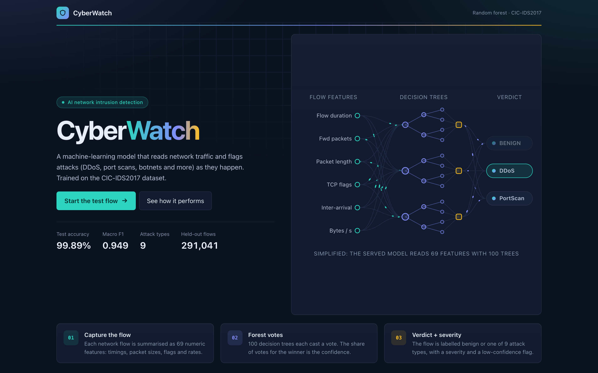
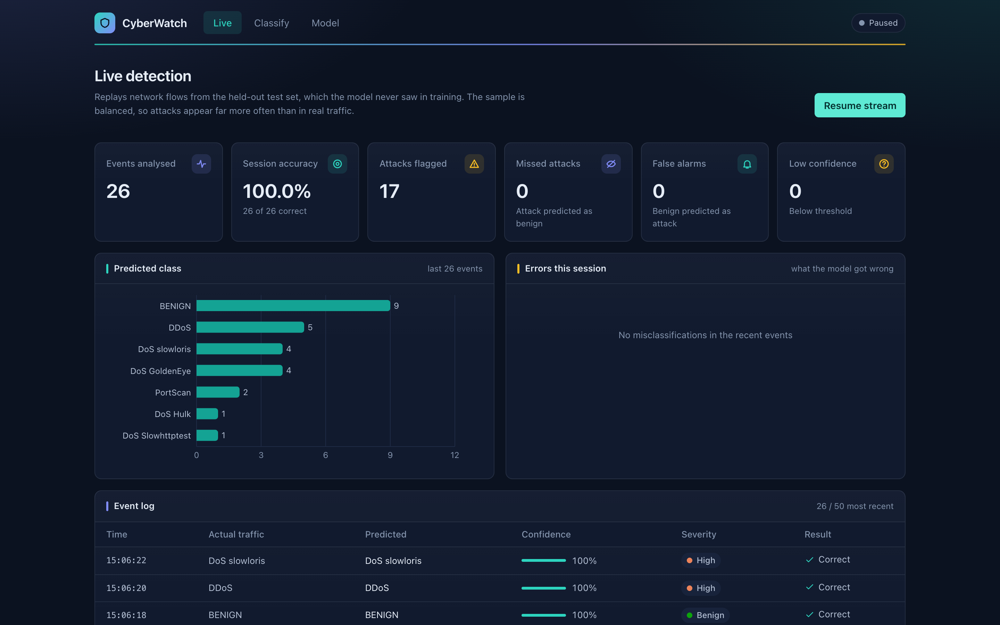
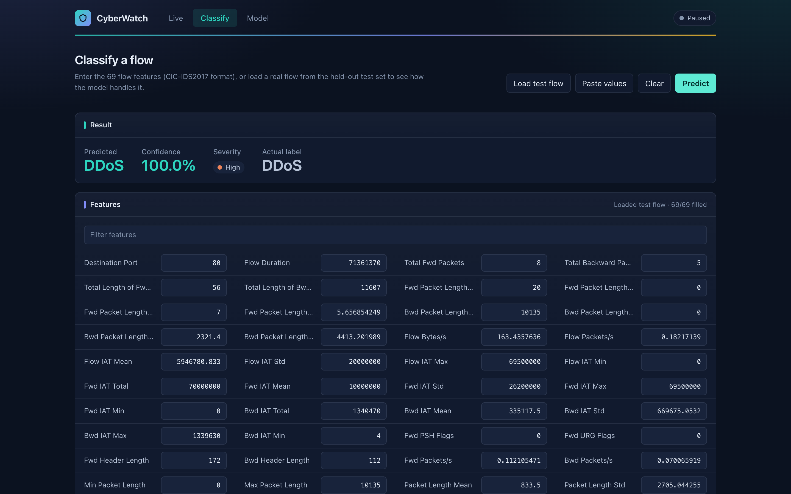
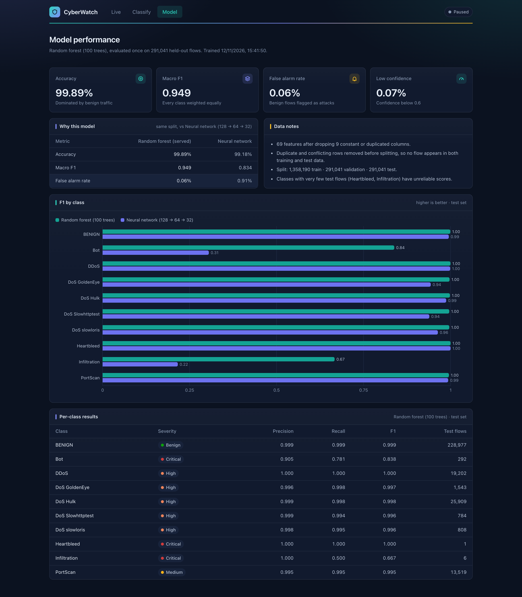
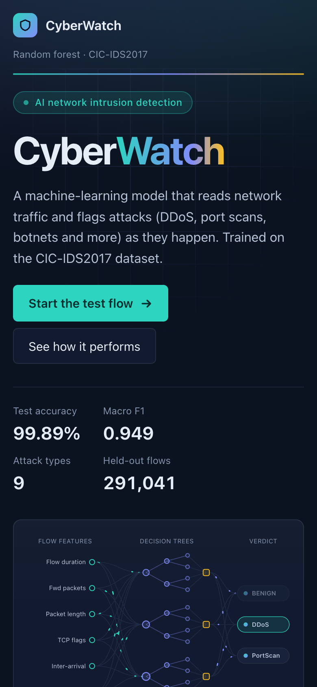
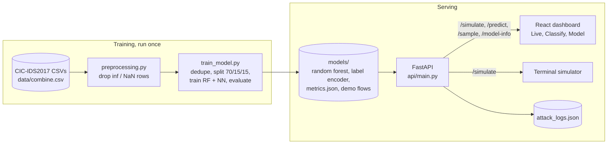

# CyberWatch

**Network intrusion detection with a random forest, served through a live dashboard.**

[](https://www.python.org/)
[](https://scikit-learn.org/)
[](https://fastapi.tiangolo.com/)
[](https://react.dev/)
[](https://vite.dev/)
[](https://www.unb.ca/cic/datasets/ids-2017.html)

CyberWatch classifies network flows from the CIC-IDS2017 dataset as benign traffic or one of
nine attack types. A random forest makes the predictions, a FastAPI backend serves them, and a
React dashboard replays held-out flows live, showing what the model got right and what it got
wrong.

There is no live packet capture. The "live" stream replays real flows from the test set, which
the model never saw during training.



---

## Contents

- [Features](#features)
- [Screenshots](#screenshots)
- [Results](#results)
- [How it works](#how-it-works)
- [Model comparison: neural network vs random forest](#model-comparison-neural-network-vs-random-forest)
- [Tech stack](#tech-stack)
- [Getting started](#getting-started)
- [Configuration](#configuration)
- [API](#api)
- [Project structure](#project-structure)
- [Limitations](#limitations)

---

## Features

- **Ten-class detection.** Sorts each flow into BENIGN, Bot, DDoS, DoS GoldenEye, DoS Hulk,
  DoS Slowhttptest, DoS slowloris, Heartbleed, Infiltration or PortScan, from 69 numeric flow
  features (timings, packet sizes, flags and rates).
- **Live replay with honest outcomes.** The dashboard streams held-out flows and labels every
  event as correct, false alarm, missed attack or wrong type, so mistakes are visible instead
  of hidden.
- **Severity and confidence.** Each prediction carries a severity based on the attack type and
  a confidence score (the share of trees that voted for it). Predictions below 0.6 are flagged
  as low confidence.
- **Classify any flow.** Load a real test flow, paste 69 values, or type them in, and get a
  prediction with its severity next to the true label.
- **Transparent evaluation.** The Model tab shows test metrics, per-class precision, recall and
  F1, and a side-by-side comparison with a neural network trained on the same split.
- **Fast, light serving.** The API loads only scikit-learn (no TensorFlow), and a single
  prediction takes about 3 ms.
- **Terminal simulator.** An optional script polls the API and prints colour-coded alerts with
  a terminal bell.

---

## Screenshots

| Live detection | Classify a flow |
|---|---|
|  |  |

**Model performance**





The layout adapts to phones: tiles and buttons stack into a single column.

---

## Results

Evaluated once on 291,041 held-out flows (after removing duplicates):

| Metric | Random forest (served) |
|---|---|
| Accuracy | 99.89% |
| Macro F1 (every class weighted equally) | 0.949 |
| False alarm rate (benign flows flagged as attacks) | 0.06% |
| Predictions below 0.6 confidence | 0.07% |

Accuracy looks high partly because 79% of flows are benign, so macro F1 is the more honest
score. The weakest class is **Bot** (recall 0.78: about one in five Bot flows is missed). Full
numbers are in `models/metrics.json` and on the dashboard's **Model** tab.

---

## How it works



1. **Prepare.** `preprocessing.py` drops rows with infinite or missing values.
   `train_model.py` then removes exact duplicates and every copy of feature vectors that carry
   conflicting labels, drops classes with fewer than 10 rows, constant columns and duplicated
   columns, leaving 69 features.
2. **Split.** The data is split 70/15/15 into train, validation and test sets, stratified so
   every class appears in each part.
3. **Train and evaluate.** The script trains the served random forest (100 trees) and a
   comparison neural network on the same split, then evaluates both once on the test set.
4. **Save.** The model, label encoder, metrics and a sample of held-out flows (up to 1,500 per
   class) are written to `models/`. These files are committed, so the app runs without the
   dataset.
5. **Serve.** The FastAPI app loads the artifacts at startup. Each request returns the
   predicted class, confidence, severity and a low-confidence flag. Severity and the threshold
   are defined only in the API; the dashboard and simulator read them from responses.
6. **Replay.** The dashboard polls `/simulate` every 2 seconds. Each call picks a random
   held-out flow, predicts it and returns the true label alongside, so the dashboard can show
   whether the model was right.

### Severity

Severity comes from the attack type, not the model's confidence. It's defined once in
`api/main.py`:

| Severity | Classes |
|---|---|
| Critical | Bot, Infiltration, Heartbleed |
| High | DDoS, DoS Hulk, DoS GoldenEye, DoS slowloris, DoS Slowhttptest |
| Medium | PortScan |

### Confidence

Confidence is the share of the forest's 100 trees that voted for the predicted class. Below
0.6, a prediction is flagged `low_confidence`, and the best guess is still returned. A low
score doesn't reliably mean the attack is new, so it isn't labelled "unknown attack".

---

## Model comparison: neural network vs random forest

The project started as a deep-learning project, so we trained two models on exactly the same
data split and kept the better one.

- **Neural network:** dense 128 → 64 → 32 → softmax, standardised inputs, square-root class
  weights, early stopping on the validation set.
- **Random forest:** 100 trees, default settings, unscaled inputs.

| Metric | Random forest | Neural network |
|---|---|---|
| Accuracy | **99.89%** | 99.18% |
| Macro F1 | **0.949** | 0.834 |
| False alarm rate | **0.06%** | 0.91% |

Per class (precision / recall):

| Class | Random forest | Neural network | Test flows |
|---|---|---|---|
| BENIGN | 0.999 / 0.999 | 0.999 / 0.991 | 228,977 |
| Bot | **0.905** / 0.781 | 0.184 / 0.890 | 292 |
| DDoS | 1.000 / 1.000 | 0.999 / 0.999 | 19,202 |
| DoS GoldenEye | 0.996 / 0.998 | 0.894 / 0.998 | 1,543 |
| DoS Hulk | 0.999 / 0.998 | 0.983 / 0.992 | 25,909 |
| DoS Slowhttptest | 0.999 / 0.994 | 0.893 / 0.990 | 784 |
| DoS slowloris | 0.998 / 0.995 | 0.947 / 0.980 | 808 |
| Heartbleed | 1.000 / 1.000 | 1.000 / 1.000 | 1 |
| Infiltration | 1.000 / 0.500 | 0.129 / 0.667 | 6 |
| PortScan | 0.995 / 0.995 | 0.987 / 0.999 | 13,519 |

**Why the random forest won.**

- **Far fewer false alarms.** At 0.91%, the network would raise about 2,000 false alerts for
  every 229,000 normal flows. The forest raises about 140.
- **Its alerts can be trusted.** Fewer than 1 in 5 of the network's "Bot" alerts were real
  bots. For the forest, 9 in 10 were.
- **Tree ensembles suit this kind of data.** On tabular data with heavy-tailed numeric
  features like these, tree ensembles usually match or beat plain neural networks, and they
  need no feature scaling.
- **Simpler to serve.** The API loads only scikit-learn (no TensorFlow), and a prediction
  takes about 3 ms.

The network catches slightly more Bot flows (recall 0.89 vs 0.78), but it pays for that with
many false alarms. `training/train_model.py` still trains both models and writes both sets of
scores to `metrics.json`, so the comparison stays reproducible.

An earlier version of the network was trained on a 200,000-row sample with SMOTE oversampling
and no duplicate removal. That version had a 3.4% false-alarm rate and 0.12 Bot precision.

---

## Tech stack

| Layer | Technology |
|---|---|
| Model | scikit-learn random forest (100 trees), joblib |
| Training | pandas, NumPy, PyArrow; TensorFlow / Keras for the comparison network only |
| Backend | Python, FastAPI, Uvicorn, Pydantic |
| Frontend | React 19, Vite, Recharts, plain CSS with design tokens |
| Simulator | Python, requests |
| Data | CIC-IDS2017 `MachineLearningCVE` flows |

---

## Getting started

### Prerequisites

- Python 3.12 or newer
- Node.js 20 or newer, with npm

### 1. Install

```bash
git clone https://github.com/Webs4Dev/cyber-watch.git
cd cyber-watch

python3 -m venv venv
source venv/bin/activate
pip install -r requirements.txt

cp .env.example .env                    # ALLOWED_ORIGINS, API_URL
cp frontend/.env.example frontend/.env  # VITE_API_URL
```

### 2. Run

```bash
uvicorn main:app --app-dir api --reload    # API on http://localhost:8000
cd frontend && npm install && npm run dev  # dashboard on http://localhost:5173
python simulator/attack_simulator.py       # optional terminal alerts
```

Open `http://localhost:5173`, press **Start the test flow**, then **Start stream**. The trained
model files are committed, so no dataset download is needed to run the app.

### 3. Retrain (optional)

Download the CIC-IDS2017 `MachineLearningCVE` CSVs from the
[Canadian Institute for Cybersecurity](https://www.unb.ca/cic/datasets/ids-2017.html). Then
concatenate them into `data/combine.csv`, keeping a single header row. The current model was
trained on the Monday, Wednesday, Thursday-afternoon and both Friday files. Adding Tuesday
(FTP-/SSH-Patator) and Thursday-morning (web attacks) would add those classes.

```bash
cd training
python explore_data.py    # class distribution of data/combine.csv
python preprocessing.py   # drops inf/NaN rows -> data/cleaned_data.csv
python train_model.py     # about 3 minutes on an M-series Mac; overwrites models/
```

Retraining regenerates every file in `models/` together, since the model's feature order and
the label encoder's class order must match.

---

## Configuration

Root `.env` (see `.env.example`):

| Variable | Used by | Description |
|---|---|---|
| `ALLOWED_ORIGINS` | API | Comma-separated browser origins allowed to call the API. Default: `http://localhost:5173` |
| `API_URL` | Simulator | Base URL of the API. Default: `http://localhost:8000` |

Frontend `frontend/.env` (see `frontend/.env.example`):

| Variable | Description |
|---|---|
| `VITE_API_URL` | Base URL of the API the dashboard calls |

---

## API

| Method | Path | Returns |
|---|---|---|
| GET | `/health` | `{"status": "ok"}` |
| GET | `/model-info` | Classes, feature names, threshold, test metrics, NN comparison, severity map |
| GET | `/simulate` | A random held-out flow's true label, the prediction, `confidence`, `low_confidence`, `severity`, `correct` |
| GET | `/sample` | A random held-out flow: `{"label", "features"}` |
| POST | `/predict` | Body `{"features": [69 numbers in /model-info order]}` → `attack_type`, `confidence`, `low_confidence`, `severity`. Returns 422 for wrong length or non-finite values |

Example:

```bash
curl -s http://localhost:8000/simulate
# {"simulated_attack": "DDoS", "predicted_attack": "DDoS", "confidence": 1.0,
#  "low_confidence": false, "severity": "high", "correct": true}
```

Interactive docs are at `http://localhost:8000/docs`.

---

## Project structure

```text
.
├── api/
│   └── main.py              FastAPI app: loads the model, severity map, all endpoints
├── frontend/                React + Vite dashboard
│   ├── DESIGN.md            Palette, type and component rules
│   └── src/
│       ├── App.jsx          Tabs, polling loop and session stats
│       ├── api.js           All API calls
│       ├── format.js        Shared constants and formatting helpers
│       ├── components/      Shared UI (cards, stat tiles, badges)
│       └── pages/           Landing, Dashboard (Live), Predict (Classify), Model
├── models/                  Committed artifacts written by train_model.py
│   ├── attack_detection_rf.joblib
│   ├── label_encoder.pkl
│   ├── metrics.json         Test metrics + neural-network comparison
│   └── demo_samples.parquet Held-out flows replayed by /simulate
├── simulator/
│   └── attack_simulator.py  Terminal alerts from /simulate
├── training/
│   ├── explore_data.py      Class distribution
│   ├── preprocessing.py     Drops inf/NaN rows
│   └── train_model.py       Cleaning, split, RF + NN training, evaluation
├── docs/screenshots/        Images used in this README
├── .env.example             API and simulator configuration template
└── requirements.txt         Python dependencies
```

---

## Limitations

- CIC-IDS2017 is a lab dataset recorded in 2017. Scores this high rarely carry over to real
  networks.
- `Destination Port` is a feature, and some attacks in the dataset target fixed ports, so the
  model can partly learn ports rather than behaviour.
- Heartbleed (1 test flow) and Infiltration (6) are too rare for reliable scores.
- The training data covers 5 of the 8 CIC-IDS2017 files, so FTP-/SSH-Patator and web attacks
  are not detected.
- The replay sample is capped at 1,500 flows per class, so the live stream shows far more
  attacks than real traffic would.
